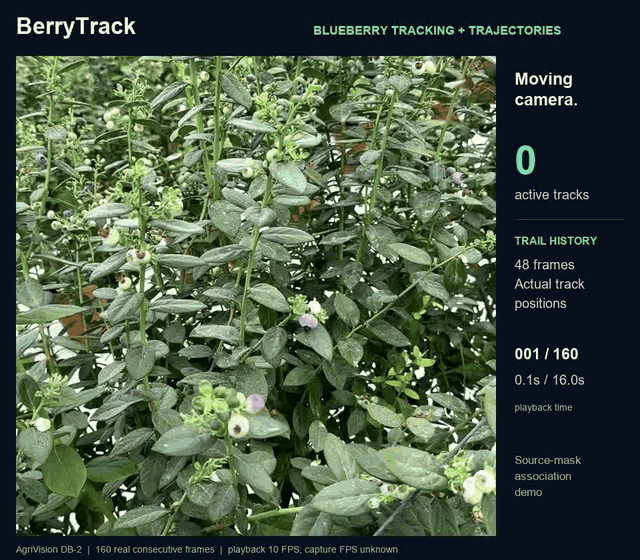
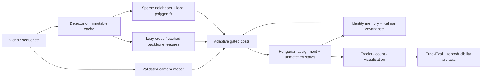
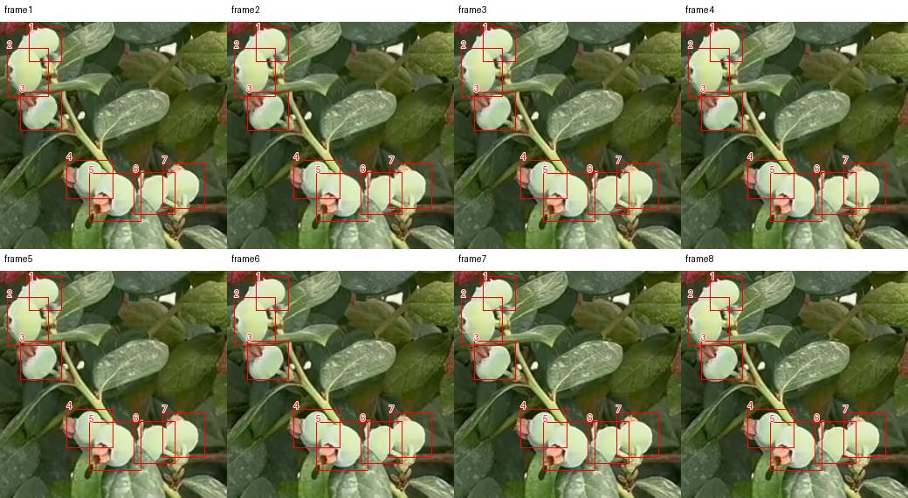

# BerryTrack

**Geometry-aware multi-object tracking for dense agricultural scenes, combining
adaptive embeddings, motion compensation, and uncertainty-guided identity association.**

Blueberries are small, crowded and visually similar. A moving camera changes their
apparent positions; occlusion can break tracks and inflate unique-fruit counts.
BerryTrack is an executable research implementation with detector-independent
baselines, validated MOT metrics, a local video application and bounded GPU jobs.

**Research question:** can adaptive appearance, camera compensation and local
geometry improve identity association and counting?
The initial evidence is mixed. No novelty, superiority or validated blueberry
tracking accuracy is claimed.

[Methods](docs/research.md) · [Dataset audit](docs/datasets.md) ·
[Evaluation](docs/evaluation.md) · [Modal guide](docs/modal.md) ·
[Executed results](results/diagnostic/report.md)

**Update:** local deformable-polygon association is implemented and enabled by
default. [Controlled results](docs/rigidity-results.md) include improvements,
regressions and a failed stationary-pixel prior. [Real blueberry frames and
explicitly assistant-reviewed labels](docs/agrivision.md) are now reproducible.

[](docs/assets/blueberry-demo.mp4)

**16 seconds of real blueberry tracking.** A moving camera, 160 consecutive
AgriVision frames and 48-frame trajectory trails from BerryTrack's actual outputs.
Inputs are box proposals from publisher-inferred masks; this qualitative demo
does not establish detector accuracy or a physical-fruit count.
[Watch the MP4](docs/assets/blueberry-demo.mp4) ·
[Source, labels and reproduction](docs/agrivision.md).

## What runs today

- Custom BerryTrack: box Kalman filtering, robust affine camera compensation,
  sparse neighborhood descriptors, adaptive costs, gated assignment, lazy
  appearance and persistent identity memory.
- Local polygons built from reliable neighbor identities: smooth affine
  deformation, robust fitting, ambiguity penalties and supported motion-gate recovery.
- Actual upstream ByteTrack, BoT-SORT and DeepSORT using identical cached detections.
- 32/64/128-dimensional compact descriptors; a trainable PyTorch encoder;
  optional ROI-pooled detector features and sparse graph attention.
- Verified BUTom-ST21 RGB/identity and BlueberryDCM detection ingestion,
  manifests, checksums, MOT conversion, loaders and manual annotation exchange.
- TrackEval HOTA/DetA/AssA, IDF1, CLEAR metrics, counting errors, timings and plots.
- Gradio upload, comparison, trajectories, cumulative IDs, switch-frame inspection
  with GT, H.264 export and MOT/JSON downloads.
- Real T4 training, checkpoint resumption and inference on persistent Modal Volumes.

The default CPU benchmark uses an **untrained** compact appearance descriptor.
Learned encoder execution is verified separately. Sparse graph attention has unit
coverage but no trained tracking result. Scientific limitations remain explicit.

## Setup

Use Python 3.12 and [uv](https://docs.astral.sh/uv/), from the repository root:

```powershell
uv sync --locked --dev
uv run berrytrack version
uv run ruff check .
uv run ruff format --check .
uv run mypy src/berrytrack
uv run pytest
```

CPU tests require neither Modal credentials nor a GPU. Tests never download model
weights or datasets. Dependencies are locked in `uv.lock`; automatic Ultralytics
dependency installation is disabled and `lap` is explicitly locked.

## Reproduce the association diagnostic

```powershell
uv run scripts/prepare_public_data.py butom
uv run python -m berrytrack.evaluation.benchmark --sequence data/processed/butom-st21-235 --oracle --ablations --dimensions 32 64 128 --seeds 42 43 44 --output artifacts/association
```

The downloader streams two small RGB sequences and validates the complete
annotation archive's publisher MD5. The partial RGB archive cannot receive its
whole-file checksum; per-frame hashes and this limitation are recorded. Cached
source files are checked against saved hashes before reuse.

`--oracle` removes identities from human-corrected GT boxes, then caches the
boxes once. This isolates association. It is **not detector performance**, a
blueberry result or an official full BUTom benchmark. All 63 annotated frames of
sequence 235 are used, with 84 original identities. Unannotated warm-up frames are
excluded, never treated as empty GT.

To evaluate actual detector outputs:

```powershell
uv run berrytrack cache-detections data/processed/butom-st21-235 --weights checkpoints/blueberry-via/best.pt --output data/processed/butom-st21-235/det/det.txt
uv run python -m berrytrack.evaluation.benchmark --sequence data/processed/butom-st21-235 --seeds 42 --output artifacts/detector-transfer
```

This example transfers a blueberry detector to tomatoes: its poor result is a
domain-shift diagnostic. Detector AP and association performance are separate
measurements. Broader experiments need a detector trained on independent,
compatible recordings.

## Video application

The blueberry GIF above shows BerryTrack only.
[Source attribution and processing](docs/assets/README.md).

```powershell
uv run berrytrack demo
```

Open [the local app](http://127.0.0.1:7860). Upload an agricultural video, choose a
tracker and comparison, and supply adapted detector weights. It runs locally on
CPU. Generic COCO weights are unreliable for
blueberries. Ripeness/visibility labels collapse to one physical-fruit tracking
class so classifier changes cannot force new identities.

[Application controls, exports and verification](docs/demo.md).

Recreate the long single-tracker blueberry GIF and H.264 video:

```powershell
uv run scripts/prepare_blueberry_demo.py
uv run scripts/make_blueberry_demo.py
```

The renderer runs BerryTrack on component boxes extracted from inferred masks,
without temporal IDs. The MP4 contains all 160 frames at 10 FPS; the GIF samples
every second frame at 5 FPS for the same 16-second duration. The fixed full-frame
view preserves real camera motion. Trails show up to 48 previous frame positions
and break across missing observations. Source capture FPS is unknown. Downloaded
datasets and model weights stay outside Git. [Source details](docs/agrivision.md).

Normal inference and optional appearance alternatives:

```powershell
uv run berrytrack track your-video.mp4 --weights checkpoints/blueberry-via/best.pt --compare botsort --output artifacts/your-video
uv run berrytrack track your-video.mp4 --weights checkpoints/blueberry-via/best.pt --reuse-backbone --output artifacts/backbone
uv run berrytrack track your-video.mp4 --weights checkpoints/blueberry-via/best.pt --encoder checkpoints/encoder-dev/encoder.pt --output artifacts/encoder
```

Backbone feature reuse has been executed and checked for finite 64D features.
Its tracking accuracy still needs controlled evaluation. Counts represent
confirmed tracker identities, not guaranteed physical-fruit totals.

## Architecture and mathematics



$$
C(i,j)=\alpha_{ij}D_{\mathrm{appearance}}+
\beta_{ij}D_{\mathrm{motion}}+
\gamma_{ij}D_{\mathrm{geometry}}+
\delta_{ij}D_{\mathrm{context}}.
$$

Terms lie in $[0,1]$. Coefficients form a simplex and adapt to available appearance,
track uncertainty, camera support and neighborhood occupancy. Missing terms are
removed before normalization. High-confidence matching precedes weak-detection
recovery; weak detections cannot initialize tracks.

The camera model rejects unsupported transforms instead of assuming a global
homography fits a non-planar canopy. The neighborhood graph is sparse; current
pair costs and Hungarian assignment are dense. See the
[derivations, assumptions and complexity](docs/research.md).

## Current polygon comparison

Fixed-weight local geometry gives the following three-seed mean HOTA on two
human-corrected tomato development sequences, using identical reference boxes:

| Sequence | Legacy | Local polygons (default) | BoT-SORT |
|---|---:|---:|---:|
| BUTom235 | 83.65 | 84.17 | 82.44 |
| BUTom205 | 89.92 | 89.85 | 86.22 |

On235, mean identity switches decrease from31.67 to19; final-count MAE remains4.
On205 there is a slight HOTA regression and count MAE remains1. With actual
transferred-detector outputs on235, HOTA stays26.69. Results are mixed and do not
establish superiority. Residual image-velocity damping performs badly and is
disabled by default; world stationarity does not imply stationary pixels.
[Full comparison, negative results and timing caveats](docs/rigidity-results.md).

## Historical executed results

The tables below preserve the **original, pre-polygon implementation**. Add
`--legacy` to the association command to reproduce those settings. The updated
tracker enables deformable-polygon consistency by default; the optional residual
velocity damping remains off. Updated controlled comparisons are recorded separately.

**Oracle-box diagnostic: BUTom235, one tomato clip, three descriptor seeds
(42/43/44).** Metrics are percentages. Warm timing excludes the first five online
frames; all frames remain in accuracy metrics. Cold, full-online and per-frame
timings are retained. Seed deviations are not uncertainty across videos.

| Tracker | HOTA | IDF1 | ID switches | Count MAE | Warm ms/frame |
|---|---:|---:|---:|---:|---:|
| ByteTrack | 59.12 ±0.00 | 70.49 ±0.00 | 123.0 | 81.0 | 1.69 |
| BoT-SORT, default ReID off | 82.44 ±0.00 | 89.48 ±0.00 | 30.0 | 18.0 | 7.38 |
| DeepSORT, compact appearance | 75.65 ±0.36 | 76.55 ±0.52 | 108.3 | 61.7 | 17.96 |
| BerryTrack | 83.65 ±0.44 | 91.35 ±0.44 | 31.7 | 4.0 | 23.99 |

BerryTrack is slower than BoT-SORT here and has slightly more switches. Its HOTA
and count on one ideal-box clip do not establish general superiority.

| Cumulative ablation | HOTA mean | Count MAE mean | Crops mean |
|---|---:|---:|---:|
| Appearance only | 36.70 | 45.0 | 1880.0 |
| Motion only | 83.28 | 10.0 | 0.0 |
| Appearance + motion | 84.01 | 7.7 | 1880.0 |
| + camera compensation | 82.75 | 2.3 | 1880.0 |
| + local context | 82.74 | 2.0 | 1880.0 |
| + adaptive weights | 83.37 | 2.0 | 1880.0 |
| + uncertainty trigger | 83.65 | 4.0 | 1059.7 |

Context did not improve mean HOTA in this ladder. Camera compensation reduced
switches but hurt HOTA relative to appearance+motion. Lazy appearance reduced
crops by 43.6% and paired warm latency from 27.63 to 23.39ms, while count MAE
worsened from 2 to 4. H1–H4 remain unproven.
[Full analysis and dimensions](docs/evaluation.md).

[Executed diagnostic plots and failure analysis](docs/evaluation.md).

**Actual detections, cross-crop transfer:** on the same tomato clip, the
blueberry detector gives BerryTrack HOTA 26.69 versus BoT-SORT 27.13, ByteTrack
20.48 and compact DeepSORT 33.29. This negative transfer result exposes the
detector bottleneck. [Full outputs](results/detector-transfer/report.md).

**Corrected BlueberryDCM detection validation:** after 20 small-data epochs on
32 training images, a separate 21-image development validation gives mAP50
**28.67%** and mAP50–95 **16.82%**. The image split may share plants and is not
independent field or tracking evidence. The 21 reserved test images were not
evaluated. Source TXT/VIA inconsistencies are [audited](results/detection/audit.json).
An initial collapsed-label pilot is preserved for provenance and excluded from
four-class conclusions.

## Data and licensing

| Dataset | License / access | Temporal identities |
|---|---|---|
| [AgriVision blueberries](https://doi.org/10.6084/m9.figshare.29222462.v1) | CC-BY-4.0; bounded real-video subsets downloaded | Inferred masks lack persistent IDs; tiny assistant-reviewed ROI added |
| [BlueberryDCM](https://zenodo.org/records/14002517) | CC-BY-NC-4.0; downloaded and checked | Static images only |
| [BUTom-ST21](https://doi.org/10.60507/FK2/TTPCNV) | CC-BY-4.0; two real RGB/hand-corrected subsets | Consistent original IDs preserved |
| [NeSTCount](https://zenodo.org/records/21636487) | CC-BY-4.0; original images on request | ID annotations available; images pending |

The [audit](docs/datasets.md) records URLs, releases, checksums and label semantics.
Automatically generated masks and pseudo labels are not tracking GT. Both
downloaded BUTom sequences are official evaluation sequences; development
training on 205 is disclosed and does not reproduce the official protocol.

To prepare a genuinely verified blueberry identity set:

```powershell
uv run berrytrack annotation-task your-video.mp4 task.json --frames 100 --license-name CC-BY-4.0
# A human annotates persistent identities and reviews every frame.
uv run berrytrack export-annotations task.json gt.txt
```

The exporter rejects pending/pseudo labels, missing reviewers and incomplete
coverage. A new8-frame/7-ID reference is explicitly labeled assistant visual
review, without human verification. It is an easy execution check, not independent
tracking GT. No human-verified blueberry benchmark is claimed.

Reconstruct real blueberry video and reproduce the visual-reference labels:



These are real blueberry frames, with assistant-authored labels and no independent
human verification. [Attribution and modifications](docs/assets/README.md).

```powershell
uv run scripts/prepare_agrivision.py --output data/processed/agrivision-new --reference-output data/processed/agrivision-reference-new
uv run python experiments/blueberry.py --sequence data/processed/agrivision-reference-new --output artifacts/blueberry-reference
```

The downloader obtains selected contiguous frames by HTTP ranges; the original
24-frame subset required54.3MB rather than the78GB archive. Source capture FPS is
unknown;10FPS is an explicit playback choice. Inferred masks and authored labels
retain distinct provenance. [Details and limits](docs/agrivision.md).

## GPU training

```powershell
$env:PYTHONUTF8 = "1"
uv run scripts/prepare_public_data.py blueberrydcm
uv run scripts/prepare_detector.py
# Upload prepared data first; full commands are in docs/modal.md.
uv run scripts/modal_job.py train-encoder --seconds 180 --options-file configs/encoder-smoke.json
uv run scripts/modal_job.py train-detector --seconds 180 --options-file configs/detector-via.json
```

Real T4 runs include 30 encoder steps, resumption to 35, 498 inference crops,
and detector training/validation. The 64D encoder has 27,744 parameters. Four named
Volumes persist data, checkpoints, features and artifacts. No GPU endpoint is
deployed. CPU preprocessing is separate from GPU allocation.

[Execution records](results/cloud/runs.json) · [Training workflow](docs/modal.md).

## Reproducibility and remaining research

The package uses `src/`, validated YAML configuration, deterministic seeds where
practical, Ruff, mypy, CPU unit/integration tests and Windows/Linux GitHub Actions.
Generated test fixtures validate engineering contracts only; no synthetic tracker
sequence is reported as a research benchmark. Results record source/cache/GT
hashes, environment versions and complete settings.

Pending research includes human-verified blueberry video IDs, independent plant/
recording splits, broader sequence evaluation, calibrated uncertainty, trained
graph context and controlled learned/backbone ReID comparisons. Long occlusions
and re-entry can still overcount. The current detector is preliminary and
occluded-fruit performance is weak. Unexecuted work has no hypothetical scores.

## Inspirations and software

[ByteTrack](https://github.com/FoundationVision/ByteTrack),
[BoT-SORT](https://github.com/NirAharon/BoT-SORT),
[DeepSORT](https://github.com/nwojke/deep_sort),
[TrackEval / HOTA](https://github.com/JonathonLuiten/TrackEval),
[PAg-NeRF / BUTom-ST21](https://github.com/Agricultural-Robotics-Bonn/BUTom21-ST21),
[Ultralytics](https://github.com/ultralytics/ultralytics) and the
[NeSTCount record](https://zenodo.org/records/21636487) inform this work. Existing
neighborhood-structure research matters when assessing novelty; this project
does not claim to originate that idea.

Software is [AGPL-3.0-or-later](LICENSE), consistent with the integrated
Ultralytics dependency. Data, images and models retain independent terms;
BlueberryDCM is noncommercial. [Third-party notices](docs/licenses.md).
