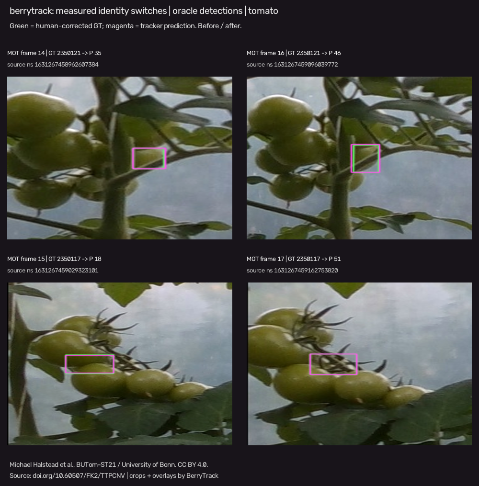

# Evaluation protocol

The main table in this document records the original pre-polygon implementation.
Use `--legacy` to reproduce it. The current default and the explicitly preserved
failed stationary-pixel prior are compared in [the polygon experiment](rigidity-results.md).
The tiny blueberry execution reference is an exploratory visual check and is not an
independent human-verified benchmark.

BerryTrack calls the installed [TrackEval](https://github.com/JonathonLuiten/TrackEval)
implementation of HOTA, CLEAR and Identity. HOTA, DetA and AssA average the 19 IoU
thresholds from 0.05 through 0.95. CLEAR and Identity use 0.5 IoU. Percentage metrics
are reported on a 0–100 scale; switches, fragments and counts are integers.
Both GT and predictions must contain one foreground class and no duplicate ID in
the same frame. GT rows with confidence/mark zero are excluded. Dataset-specific
ignore regions and distractors must be handled during conversion; this is not a
drop-in reproduction of the pedestrian MOTChallenge leaderboard protocol.

Missing annotation files are **unknown coverage**, not object-free frames.
The metrics adapter accepts an explicit annotated frame list and filters both
predictions and GT to that coverage. The BUTom converter exports only frames with
official hand-corrected annotations and retains original timestamps in its
manifest. Its resulting frame indices are contiguous, but the researcher must
inspect temporal gaps before making motion-related claims.

`count_error` is final predicted unique IDs minus final annotated unique IDs.
For one sequence, count MAE and RMSE both equal the absolute error. Their values
are not estimates across crops or videos. For several sequences, aggregate the
signed per-sequence errors as `mean(abs(errors))` and `sqrt(mean(errors**2))`.
The separate cumulative-count errors compare unique identities observed up to
each evaluated frame; they measure a different quantity from final count error.

Association latency includes tracker updates, GMC and any crop feature
extraction executed by the tracker. The reported warm average and tracking FPS
exclude the first five online frames, without dropping frames from metrics
or changing predictions. The runner retains cold first-frame latency, all-frame
association averages, per-frame durations, and full pipeline wall time separately.
Association timing excludes frame decoding, detector inference
and metric computation. Pipeline latency also includes image decoding and result
collection but excludes the detector. Unmeasured end-to-end detector latency and
peak GPU memory are null, never zero. Model parameter count is zero in the compact
classical-descriptor CPU diagnostic. A learned encoder must report its actual
parameter count and synchronized GPU latency separately.

Baseline adapters run [Ultralytics ByteTrack and BoT-SORT](https://github.com/ultralytics/ultralytics/tree/main/ultralytics/trackers).
BoT-SORT uses its documented default ReID-disabled configuration with sparse
optical-flow camera compensation. DeepSORT uses the
[deep-sort-realtime](https://github.com/levan92/deep_sort_realtime) implementation
with shared compact descriptors or explicitly supplied cached embeddings;
the report labels this descriptor and does not imply learned person-ReID weights.
All use identical cached boxes, scores, image sizes and frame lifetimes. Native
track confirmation policies differ and are retained, so the full configuration
and initial-frame effects must be considered when interpreting the comparison.

## Hypotheses and evidence

- H1: compare camera versus context across separated sequences with fixed detector.
- H2: compare appearance+motion versus camera, stratifying measured camera movement.
- H3: compare adaptive always-on versus uncertainty; compare HOTA/IDF1 jointly with crop counts and latency.
- H4: compare sequence-level unique-count errors jointly with switches and fragmentation.

The accessible development diagnostic can expose failures and validate plumbing.
It cannot establish agricultural generalization, novelty, superiority, or prove
these hypotheses. The three recorded seeds change descriptor projection; repeated
deterministic baselines produce identical accuracy. Seed standard deviations are
not confidence intervals across videos. Retain negative results. Hyperparameters are fixed before
evaluation; do not select them using the final test set. Human-verified blueberry
tracking annotations and a broader train/validation/test sequence split remain
pending until data and annotation work permit a valid study.

## Executed development diagnostic

The committed [full results](../results/diagnostic/results.json),
[per-seed CSV](../results/diagnostic/summary.csv),
[seed means and standard deviations](../results/diagnostic/summary_by_variant.csv),
and [comparison plot](../results/diagnostic/comparison.png) were produced by running
the repository on BUTom-ST21 sequence 235: 63 annotated frames, 1,880 human-corrected
boxes and 84 identities. All trackers received the same oracle boxes with identities
removed, plus original images. This is a **single tomato development clip**.
There is no detector inference in these measurements.

Means across descriptor seeds 42, 43, 44; `±` is sample standard deviation across
these settings, not uncertainty across videos:

| Method | HOTA | IDF1 | ID switches | Final-count MAE | Warm association ms |
|---|---:|---:|---:|---:|---:|
| ByteTrack | 59.12 ± 0.00 | 70.49 ± 0.00 | 123.0 | 81.0 | 1.69 ± 0.05 |
| BoT-SORT, default ReID off | 82.44 ± 0.00 | 89.48 ± 0.00 | 30.0 | 18.0 | 7.38 ± 0.27 |
| DeepSORT, compact descriptor | 75.65 ± 0.36 | 76.55 ± 0.52 | 108.3 | 61.7 | 17.96 ± 0.65 |
| BerryTrack | 83.65 ± 0.44 | 91.35 ± 0.44 | 31.7 | 4.0 | 23.99 ± 1.25 |

BerryTrack is slower than BoT-SORT here and has slightly more identity switches.
Its better HOTA/IDF1 and final count on this one oracle-box clip do not establish
generalization or superiority. Compact descriptors have zero learned parameters;
these results do not test the separately implemented trainable encoder.

| Ablation | HOTA mean | IDF1 mean | ID switches mean | Count MAE mean | Appearance crops mean |
|---|---:|---:|---:|---:|---:|
| Appearance only | 36.70 | 38.79 | 103.7 | 45.0 | 1880.0 |
| Motion only | 83.28 | 88.59 | 28.0 | 10.0 | 0.0 |
| Appearance + motion | 84.01 | 91.40 | 42.0 | 7.7 | 1880.0 |
| + camera | 82.75 | 90.31 | 33.7 | 2.3 | 1880.0 |
| + context | 82.74 | 90.08 | 27.0 | 2.0 | 1880.0 |
| + adaptive weights | 83.37 | 90.81 | 29.0 | 2.0 | 1880.0 |
| + uncertainty trigger | 83.65 | 91.35 | 31.7 | 4.0 | 1059.7 |

H1 remains mixed: context reduces switches in this ladder but does not improve
mean HOTA. H2 is also mixed: camera compensation reduces switches and final count
error, while HOTA and IDF1 decrease relative to appearance+motion. For H3, lazy
appearance reduces crop extractions by about 43.6% and warm latency from 27.63 to
23.39ms in the paired adaptive/uncertainty variants, but count MAE worsens from 2
to 4. H4 is therefore not a monotonic relationship in this clip. None of these
observations proves a hypothesis. Keep these negative and mixed findings when
planning the broader held-out study.



The montage shows two measured BerryTrack failures with source timestamps and
original GT identities: one fruit receives a different predicted identity after
brief occlusion. Green boxes are human-corrected source annotations and magenta
boxes are tracker outputs. The heavy occlusion and similar neighboring structures
illustrate remaining ambiguity. Attribution and modifications are recorded in
[the asset notice](assets/README.md) and [event provenance](assets/identity-switches.json).
Recreate it with:

```powershell
uv run python -m berrytrack.evaluation.qualitative --sequence data/processed/butom-st21-235 --results results/diagnostic/results.json --output docs/assets/identity-switches.png
```
